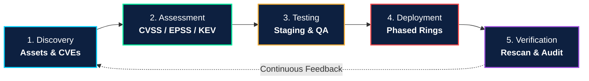

<div align="center">

# 🛡️ Enterprise Patch Management & Vulnerability Remediation

### *Strategic Guide to Vulnerability Management, Enterprise Resilience, and Cyber Hygiene*

[](https://github.com/rabigupta-123)
[](https://doi.org/10.6028/NIST.SP.800-40r4)
[](https://www.cisa.gov/known-exploited-vulnerabilities-catalog)
[](https://oasisinfobyte.com/)
[](https://github.com/rabigupta-123/patch_management_report.md/actions/workflows/validate_report.yml)
[](LICENSE)

<br/>


<br/>

**Author:** [Rabi Kumar Gupta](https://github.com/rabigupta-123) • **Program:** Ethical Hacking Internship (Week 6) • **Date:** October 2026

---

</div>

## 📌 Executive Overview

In contemporary cybersecurity, vulnerability exploitation has overtaken credential compromise as the **#1 initial attack vector**, accounting for approximately **31% of all confirmed enterprise breaches** (Verizon DBIR). 

Despite tens of thousands of newly discovered CVEs every year, catastrophic intrusions rarely originate from sophisticated zero-days. Instead, **over 80% of persistent cyberattacks exploit known vulnerabilities for which security patches had already been published months or years prior**.

This repository contains the comprehensive research report: [**The Importance of Patch Management: A Strategic Guide to Vulnerability Remediation, Enterprise Resilience, and Cyber Hygiene**](patch_management_report.md). The report synthesizes empirical threat data, regulatory mandates, case study reconstructions, and the **NIST SP 800-40 Rev. 4** framework into an actionable operational program.

---

## 📑 Core Report Highlights

Read the complete research report here: 📄 [**patch_management_report.md**](patch_management_report.md)

### 1. The Vulnerability & Patch Lifecycle
- **Vulnerability Cataloguing:** How vulnerabilities progress from discovery and coordinated disclosure (CVD) to MITRE CVE assignments, CVSS v3.1/v4.0 scoring, and CISA Known Exploited Vulnerabilities (KEV) listings.
- **The Patch Diffing Paradox:** How threat actors use binary diffing tools (Ghidra, BinDiff) to reverse-engineer security patches within 24–72 hours of release, making the window between *patch release* and *patch rollout* the most perilous window for an enterprise.
- **The Exposure Window Equation:** $W_{exposure} = T_{patch\_applied} - T_{exploit\_public}$.

### 2. Deep-Dive Breach Case Studies
- **WannaCry Ransomware (2017):** Exploitation of SMBv1 (CVE-2017-0144 / MS17-010) via EternalBlue. Impacted 230,000+ computers across 150+ countries. Crippled 81 NHS trusts in the UK with £92M ($121.7M) in damages—*two months after Microsoft released the patch*.
- **Equifax Data Breach (2017):** Exploitation of Apache Struts 2 (CVE-2017-5638) exposing 147.9 million consumers' PII. Caused by an incomplete software inventory and scanner configuration errors, resulting in over $1.38 billion in settlements and infrastructure overhaul.

### 3. Empirical Threat Metrics (Verizon DBIR)
- **31%** of breaches initiated through vulnerability exploitation (surpassing credentials at 13%).
- **43 Days:** Median enterprise time-to-remediate a critical vulnerability.
- **Only 26%** of CISA KEV flaws fully remediated across enterprises in 2025.
- **80%** of active exploits target CVEs older than 2 years.

---

## 🔄 The 5-Phase Patch Management Lifecycle

Adhering to the **NIST SP 800-40 Rev. 4** framework, this model establishes a continuous, risk-based operational cycle:



| Phase | Core Objective | Key Tooling / Mechanisms |
|---|---|---|
| **1. Discovery** | Maintain complete real-time hardware, software, and container inventory | CMDB, Active Directory, Nmap, Qualys Cloud Agent, Tenable Nessus |
| **2. Assessment** | Prioritize vulnerabilities using real-world exploit likelihood, not just CVSS | CISA KEV Catalog, FIRST EPSS, Asset Criticality Matrix |
| **3. Testing** | Validate patch stability and eliminate application regressions | Isolated Staging Sandbox, Automated Smoke Tests, Hypervisor Snapshots |
| **4. Deployment** | Roll out patches across controlled rings to minimize operational risk | Ring 0 (Canary) → Ring 1 (Pilot) → Ring 2 (Prod) → Ring 3 (Critical) |
| **5. Verification** | Confirm remediation in memory and generate compliance evidence | Post-patch Rescan, Service Restart Verification, Splunk/SIEM Audit Logs |

---

## ⏱️ Enterprise Patching SLA Matrix

| Vulnerability Severity | Criteria & Impact | Standard SLA | Emergency SLA (Active KEV) |
|:---:|---|:---:|:---:|
| 🔴 **Critical** | CVSS 9.0–10.0, Remote Code Execution (RCE), unauthenticated network vector | **≤ 7–14 Days** | **≤ 24–48 Hours** |
| 🟠 **High** | CVSS 7.0–8.9, Privilege escalation, sensitive data exfiltration | **≤ 30 Days** | **≤ 7 Days** |
| 🟡 **Medium** | CVSS 4.0–6.9, Local Denial of Service (DoS), Cross-Site Scripting (XSS) | **≤ 60 Days** | **≤ 14 Days** |
| 🔵 **Low** | CVSS 0.1–3.9, Minor information disclosure, high complexity local bugs | **≤ 90 Days** | **≤ 30 Days** |

---

## ✅ Best Practices: 7-Step Implementation Checklist

- [x] **Step 1: Real-Time Asset & Dependency Inventory**
  - Continuous network discovery and CMDB synchronization.
  - Software Bill of Materials (SBOM) for third-party libraries.
- [x] **Step 2: Risk-Based Prioritization (EPSS + CVSS + KEV)**
  - Automated ingestion of CISA KEV updates.
  - Correlation with EPSS probability (> 0.50 score triggers escalation).
- [x] **Step 3: Define & Enforce Contractual SLAs**
  - Documented service level agreements across IT Operations and Security.
  - Executive escalation protocols for SLA breaches.
- [x] **Step 4: Standardize Isolated Staging Sandboxes**
  - Dedicated pre-production testbeds mirroring production OS stacks.
  - Automated regression testing and backup/rollback snapshots.
- [x] **Step 5: Phased Deployment Rings & Rollback Strategy**
  - Ring 0 Canary (5%) → Ring 1 Pilot (20%) → Ring 2 Broad (70%) → Ring 3 Mission-Critical.
  - Pre-approved rollback commands and hypervisor restore points.
- [x] **Step 6: Centralized Patch Orchestration & Automation**
  - Automated policy enforcement (Microsoft Intune, Red Hat Satellite, Ansible).
  - Bandwidth throttling and off-network cloud distribution for remote workers.
- [x] **Step 7: Independent Post-Deployment Verification & Audit**
  - Credentialed rescanning to ensure vulnerabilities are closed in memory.
  - Audit logging for PCI-DSS, HIPAA, GDPR, and ISO 27001 compliance.

---

## 📂 Repository File Structure

```
patch_management_report/
│
├── .github/
│   └── workflows/
│       └── validate_report.yml       # Automated CI workflow validating report & standards
│
├── assets/
│   └── patch_management_lifecycle.png # High-resolution architecture infographic
│
├── .gitignore                         # Standard hygiene exclusion list
├── patch_management_report.md         # Full research report & implementation guide
└── README.md                          # Repository documentation & executive overview
```

---

## ⚙️ Automated CI / CD Workflow

This repository includes a GitHub Actions validation pipeline located at [`.github/workflows/validate_report.yml`](.github/workflows/validate_report.yml):
- **Triggers:** Automatically runs on every `push` and `pull_request` to `main`.
- **Integrity Checks:** Validates repository file presence, asset paths, and markdown documentation completeness.
- **Compliance:** Ensures all research deliverables adhere to Oasis Infobyte internship submission criteria.

---

## 👨‍💻 Author & Acknowledgments

- **Author:** [Rabi Kumar Gupta](https://github.com/rabigupta-123)
- **Role:** Cybersecurity & Ethical Hacking Intern
- **Organization:** [Oasis Infobyte](https://oasisinfobyte.com/)
- **Program:** Cybersecurity Internship Program — Task 6 (October 2026)
- **Framework References:** NIST SP 800-40 Rev. 4, CISA KEV, Verizon DBIR, MITRE CVE

---

## 📜 License

This research repository is licensed under the **MIT License** — feel free to utilize, distribute, and reference this material for academic, research, and enterprise cybersecurity training purposes.