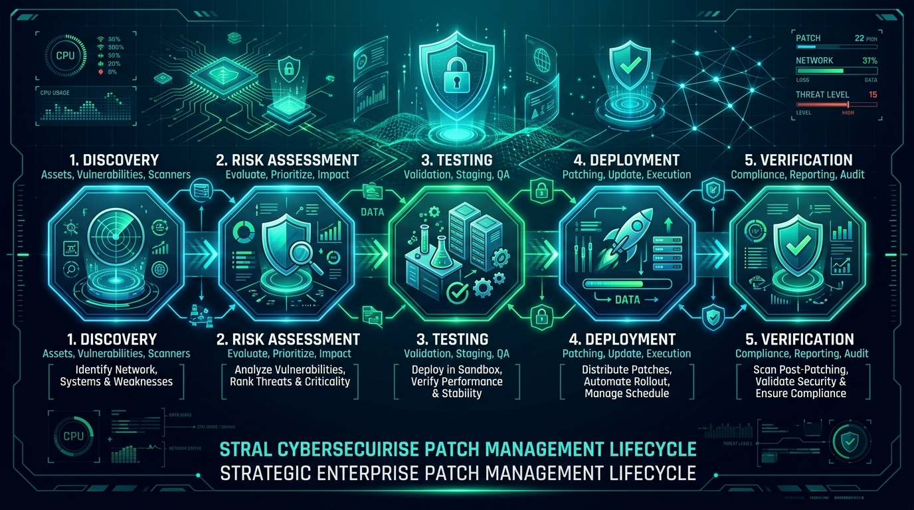
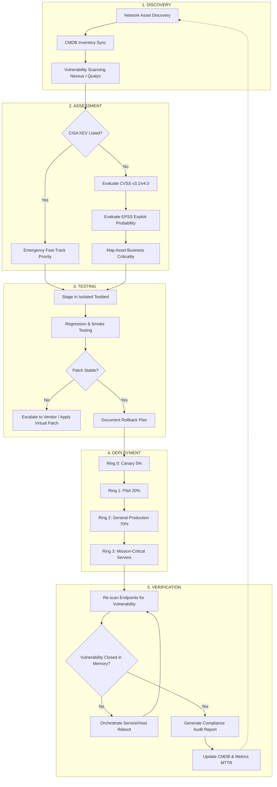

# The Importance of Patch Management: A Strategic Guide to Vulnerability Remediation, Enterprise Resilience, and Cyber Hygiene

**Author:** Rabi Kumar Gupta  
**Task:** Week 6 — Ethical Hacking Internship  
**Date:** October 2026  
**Institution:** Oasis Infobyte Cybersecurity Internship  
**Document Status:** Final Professional Report  

---



---

## Executive Summary

In modern cyberspace, vulnerability exploitation is the primary initial access vector for enterprise cyberattacks. While thousands of new Common Vulnerabilities and Exposures (CVEs) are catalogued annually, catastrophic incidents rarely stem from sophisticated, unannounced zero-day exploits. Instead, the overwhelming majority of breaches exploit **known, documented vulnerabilities for which security patches had already been released months or even years prior**.

Patch management represents the critical remediation phase of the vulnerability management lifecycle. Without a rigorous, automated, and risk-prioritized patching program, an enterprise's attack surface expands continuously with every software deployment. This report delivers an exhaustive analysis of enterprise patch management, supported by real-world breach case studies (WannaCry and Equifax), empirical threat intelligence from the Verizon Data Breach Investigations Report (DBIR) and CISA's Known Exploited Vulnerabilities (KEV) catalog, the five-phase NIST SP 800-40 Rev. 4 lifecycle, an actionable 7-step deployment checklist, and mitigation strategies for enterprise patching obstacles.

---

## Table of Contents

1. [Introduction](#1-introduction)
   - 1.1 [Defining Patch Management](#11-defining-patch-management)
   - 1.2 [The Vulnerability Management Context](#12-the-vulnerability-management-context)
   - 1.3 [The Window of Exposure Equation](#13-the-window-of-exposure-equation)
2. [Why Patches Matter](#2-why-patches-matter)
   - 2.1 [How Vulnerabilities Are Discovered, Reported, and Catalogued (CVEs)](#21-how-vulnerabilities-are-discovered-reported-and-catalogued-cves)
   - 2.2 [The Mechanics of Patch Diffing and Weaponization](#22-the-mechanics-of-patch-diffing-and-weaponization)
   - 2.3 [Real-World Breaches Caused by Unpatched Systems](#23-real-world-breaches-caused-by-unpatched-systems)
     - 2.3.1 [Case 1 — WannaCry Ransomware (2017)](#231-case-1--wannacry-ransomware-2017)
     - 2.3.2 [Case 2 — Equifax Data Breach (2017)](#232-case-2--equifax-data-breach-2017)
     - 2.3.3 [Comparative Analysis of Root Causes](#233-comparative-analysis-of-root-causes)
3. [Consequences of Not Patching](#3-consequences-of-not-patching)
   - 3.1 [Categorized Impact Analysis](#31-categorized-impact-analysis)
   - 3.2 [Regulatory Mandates and Legal Liability](#32-regulatory-mandates-and-legal-liability)
   - 3.3 [Empirical Threat Intelligence & DBIR Metrics](#33-empirical-threat-intelligence--dbir-metrics)
4. [The Patch Management Lifecycle](#4-the-patch-management-lifecycle)
   - 4.1 [NIST SP 800-40 Rev. 4 Framework](#41-nist-sp-800-40-rev-4-framework)
   - 4.2 [Phase 1: Discovery (Asset & Vulnerability Inventory)](#42-phase-1-discovery-asset--vulnerability-inventory)
   - 4.3 [Phase 2: Assessment (Risk, EPSS & Priority Scoring)](#43-phase-2-assessment-risk-epss--priority-scoring)
   - 4.4 [Phase 3: Testing (Pre-Deployment Validation & Staging)](#44-phase-3-testing-pre-deployment-validation--staging)
   - 4.5 [Phase 4: Deployment (Controlled Phased Rollout)](#45-phase-4-deployment-controlled-phased-rollout)
   - 4.6 [Phase 5: Verification (Post-Patch Validation & Continuous Feedback)](#46-phase-5-verification-post-patch-validation--continuous-feedback)
   - 4.7 [Lifecycle Architecture Workflow](#47-lifecycle-architecture-workflow)
5. [Best Practices: A 7-Step Patch Management Checklist](#5-best-practices-a-7-step-patch-management-checklist)
   - 5.1 [Detailed 7-Step Implementation Methodology](#51-detailed-7-step-implementation-methodology)
   - 5.2 [Enterprise Patching SLA Matrix](#52-enterprise-patching-sla-matrix)
   - 5.3 [Operational RACI Matrix and Checklist](#53-operational-raci-matrix-and-checklist)
6. [Challenges in Patch Management & Mitigation Strategies](#6-challenges-in-patch-management--mitigation-strategies)
   - 6.1 [System Downtime & High-Availability Constraints](#61-system-downtime--high-availability-constraints)
   - 6.2 [Legacy Systems, End-of-Life (EOL) Software & Technical Debt](#62-legacy-systems-end-of-life-eol-software--technical-debt)
   - 6.3 [Patch Incompatibility and Software Regressions](#63-patch-incompatibility-and-software-regressions)
   - 6.4 [Resource Constraints, Alert Fatigue & Remote Workforces](#64-resource-constraints-alert-fatigue--remote-workforces)
   - 6.5 [Third-Party Dependencies & Open-Source Supply Chains](#65-third-party-dependencies--open-source-supply-chains)
7. [Conclusion & Strategic Recommendations](#7-conclusion--strategic-recommendations)
8. [References](#8-references)

---

## 1. Introduction

### 1.1 Defining Patch Management

**Patch management** is the structured, systematic, and continuous process of identifying, acquiring, prioritizing, testing, deploying, and verifying software updates—collectively termed "patches"—across an organization's computing infrastructure. These updates address security vulnerabilities, resolve operational bugs, optimize system performance, and maintain compatibility across:

- **Operating Systems:** Windows Server/Client, Linux distributions (RHEL, Ubuntu, Debian), macOS, and Unix.
- **Enterprise Applications:** Web servers (Apache, Nginx, IIS), database management systems (PostgreSQL, MSSQL, Oracle), productivity suites, and ERP solutions.
- **Firmware & Hardware:** Network routers, firewalls, switches, server BIOS/UEFI, Baseboard Management Controllers (BMCs/IPMI), and IoT/OT sensors.
- **Third-Party Libraries & Dependencies:** Open-source runtime components (OpenSSL, Log4j, Spring), container base images, and orchestration toolchains.

According to the National Institute of Standards and Technology (NIST) Special Publication 800-40 Revision 4, enterprise patch management is officially defined as:

> *"The process for identifying, prioritizing, acquiring, installing, and verifying patches for products and systems to mitigate vulnerabilities, comply with policies, and maintain operational stability."* [1]

### 1.2 The Vulnerability Management Context

Patch management is not an isolated IT helpdesk duty; it is the **operational remediation pillar** within the broader **Vulnerability Management (VM) Lifecycle**:

```
+----------------------------------------------------------------------------+
|                     VULNERABILITY MANAGEMENT LIFECYCLE                     |
+----------------------------------------------------------------------------+
|  [1. Discover]   -->  Identify hardware, software, cloud, and edge assets  |
|  [2. Prioritize] -->  Rank vulnerabilities (CVSS, CISA KEV, EPSS, context) |
|  [3. Assess]     -->  Determine exploitability and operational risk        |
|  [4. Remediate]  -->  PATCH MANAGEMENT: Acquire, test, deploy fixes        |
|  [5. Verify]     -->  Rescan, audit compliance, validate remediation       |
|  [6. Report]     -->  Track MTTR, SLA adherence, and remaining risk        |
+----------------------------------------------------------------------------+
```

A vulnerability is only *theoretically* hazardous until two criteria converge:
1. A weaponized exploit is developed or publicly available.
2. An exposed, unpatched system running the susceptible service is accessible to an adversary.

Patch management dismantles this equation by eliminating the flaw at the source code or binary level. When patch management is absent, haphazard, or prolonged, the exposure window expands exponentially.

### 1.3 The Window of Exposure Equation

The temporal risk incurred by an enterprise is expressed by the **Window of Exposure ($W_{exposure}$)**:

$$W_{exposure} = T_{patch\_applied} - T_{exploit\_public}$$

Where:
- $T_{exploit\_public}$ is the timestamp when an exploit or actionable patch diff becomes publicly available to threat actors.
- $T_{patch\_applied}$ is the timestamp when the organization successfully rolls out the patch to 100% of susceptible endpoints and restarts dependent processes.

Whenever $T_{patch\_applied} > T_{exploit\_public}$, an adversary armed with automated scanning tools (such as Masscan, ZMap, Shodan, or Censys) can identify and exploit vulnerable hosts before defenders finish testing and rolling out updates. Modern threat actors script this entire pipeline, scanning the global IPv4 and IPv6 address space within hours of a vulnerability release.

---

## 2. Why Patches Matter

### 2.1 How Vulnerabilities Are Discovered, Reported, and Catalogued (CVEs)

Vulnerability lifecycle tracking relies on a globally recognized standardization infrastructure:

```
[1. Discovery] ────► [2. Responsible] ────► [3. CVE ID] ────► [4. CVSS & EPSS] ────► [5. Vendor Patch] ────► [6. CISA KEV]
 (Researcher/QA)      (Disclosure)          (MITRE CNA)         (Scoring)              (Fix Release)         (Active Exploit)
```

1. **Discovery:** Security analysts, academic researchers, commercial vulnerability researchers, bug bounty hunters, or malicious actors discover logic flaws, memory corruption bugs (e.g., buffer overflows, use-after-free), or injection vulnerabilities.
2. **Coordinated Vulnerability Disclosure (CVD):** The finder confidentially alerts the vendor or product maintainer under a standard 90-day disclosure window, allowing engineers to develop, test, and package a remediation before malicious actors learn of the bug.
3. **Cataloguing (CVE):** A CVE Numbering Authority (CNA)—such as MITRE, Microsoft, Red Hat, or GitHub—assigns a unique identifier conforming to `CVE-YYYY-NNNNN`. This standardized nomenclature ensures cross-industry correlation between scanners, intrusion detection systems, and vulnerability databases.
4. **Severity Scoring (CVSS):** The Common Vulnerability Scoring System (CVSS v3.1 and v4.0), governed by FIRST, evaluates the technical characteristics of a vulnerability across eight base metrics:
   - *Attack Vector (AV):* Network (N), Adjacent (A), Local (L), Physical (P).
   - *Attack Complexity (AC):* Low (L), High (H).
   - *Privileges Required (PR):* None (N), Low (L), High (H).
   - *User Interaction (UI):* None (N), Required (R).
   - *Scope (S):* Unchanged (U), Changed (C).
   - *Impact Metrics:* Confidentiality (C), Integrity (I), Availability (A).
   
   Scores range from **0.0 to 10.0** (None, Low, Medium, High, Critical).
5. **Exploit Prediction Scoring System (EPSS):** While CVSS assesses *severity*, EPSS estimates the statistical *probability* (0.0% to 100.0%) that a software vulnerability will be exploited in the wild within 30 days. Integrating EPSS enables security teams to target the 3–5% of CVEs that pose imminent threat.
6. **CISA Known Exploited Vulnerabilities (KEV) Catalog:** Maintained by the U.S. Cybersecurity and Infrastructure Security Agency, KEV acts as the definitive global ledger of vulnerabilities actively leveraged by threat groups in confirmed intrusions [2]. Under Binding Operational Directive (BOD) 22-01, federal civilian agencies are mandated to patch KEV flaws within aggressive timelines (typically 14–21 days).

### 2.2 The Mechanics of Patch Diffing and Weaponization

One of the most dangerous paradoxes in cybersecurity is **patch diffing (binary difference analysis)**:

```
+--------------------------------------------------------------------------------+
|                           THE PATCH DIFFING PARADOX                            |
+--------------------------------------------------------------------------------+
|  Vendor releases Patch X (e.g., updates DLL / ELF binary / library)            |
|       │                                                                        |
|       ▼                                                                        |
|  Adversary runs automated diffing tools (Ghidra, IDA Pro / BinDiff, Diaphora)   |
|       │                                                                        |
|       ▼                                                                        |
|  Modified assembly routines highlight EXACT buffer bounds or missing checks    |
|       │                                                                        |
|       ▼                                                                        |
|  Adversary crafts weaponized proof-of-concept (PoC) exploit in 24 to 72 hours   |
|       │                                                                        |
|       ▼                                                                        |
|  Mass-scanning bots target unpatched internet-facing servers worldwide         |
+--------------------------------------------------------------------------------+
```

When a vendor releases a security update, they distribute both updated binaries and changelogs. Attackers take the unpatched binary and the newly patched binary, feeding them into binary analysis engines like Ghidra, BinDiff, or IDA Pro. By comparing function control-flow graphs, adversaries identify the precise logic flaw that was corrected—such as an added boundary check or sanitized input. 

Consequently, **the release of a patch gives threat actors a detailed blueprint for weaponized exploitation**. Organizations that defer deployment become prime targets for automated botnets scanning the public IPv4 space.

---

### 2.3 Real-World Breaches Caused by Unpatched Systems

#### 2.3.1 Case 1 — WannaCry Ransomware (2017)

```
+--------------------------------------------------------------------------------+
|                        WANNACRY TIMELINE & ATTACK CHAIN                        |
+--------------------------------------------------------------------------------+
|  March 14, 2017 : Microsoft releases MS17-010 (CVE-2017-0144) fixing SMBv1     |
|  April 14, 2017 : Shadow Brokers leaks NSA "EternalBlue" exploit tool          |
|  May 12, 2017   : WannaCry worm unleashed; scans Port 445 globally             |
|  Within 24 Hours: 230,000+ endpoints encrypted in 150+ countries               |
+--------------------------------------------------------------------------------+
```

- **Vulnerability:** CVE-2017-0144 (Microsoft Security Bulletin MS17-010). A Critical remote code execution vulnerability in the Server Message Block version 1.0 (SMBv1) networking protocol.
- **Attack Mechanism:** The EternalBlue exploit sent maliciously crafted packets to exposed SMBv1 ports (TCP 445), gaining SYSTEM-level execution without requiring user credentials or human interaction. WannaCry coupled EternalBlue with DoublePulsar backdoor payloads and self-propagating worm capabilities.
- **Devastating Impact:** 
  - Over **230,000 computers infected across 150+ countries** in under 24 hours [3].
  - Hit the United Kingdom's National Health Service (NHS) catastrophically: **81 out of 236 hospital trusts** were disrupted, 603 primary care organizations were paralyzed, and **19,000+ clinical appointments and surgeries were cancelled**. Ambulances were diverted from emergency rooms.
  - Total financial fallout for the NHS alone was calculated by the UK National Audit Office (NAO) at **£92 million (~$121.7 million USD)**, comprising £19M in immediate lost patient care output and £73M in IT remediation and emergency system restoration [4].
- **Core Lesson:** Microsoft had released the security patch **MS17-010 two months before WannaCry hit**. The disaster occurred because enterprises failed to execute patch deployment on internal Windows workstations and server assets.

#### 2.3.2 Case 2 — Equifax Data Breach (2017)

```
+--------------------------------------------------------------------------------+
|                       EQUIFAX BREACH RECONSTRUCTION                            |
+--------------------------------------------------------------------------------+
|  March 7, 2017   : Apache Foundation releases fix for Struts (CVE-2017-5638)   |
|  March 8, 2017   : US-CERT issues public alert warning of active exploitation  |
|  March 9, 2017   : Equifax security distributes internal email to patch flaw   |
|  March 15, 2017  : Automated scans fail to detect vulnerable portal server     |
|  May 13, 2017    : Attackers discover unpatched server; begin data exfiltration|
|  July 29, 2017   : Security staff discovers breach during SSL certificate renewal|
+--------------------------------------------------------------------------------+
```

- **Vulnerability:** CVE-2017-5638 (CVSS Score: 10.0 Critical). An arbitrary remote code execution vulnerability in the Jakarta Multipart parser upload mechanism of Apache Struts 2.
- **Attack Mechanism:** Attackers sent HTTP requests containing crafted `Content-Type` headers with OGNL (Object-Graph Navigation Language) expressions. The parser mishandled the invalid header and executed arbitrary commands under the web server's service account.
- **Devastating Impact:**
  - Sensitive personal records of **147.9 million consumers** were exfiltrated, including Social Security Numbers, full legal names, dates of birth, residential addresses, and credit card credentials [5].
  - The U.S. House Committee on Oversight and Government Reform conducted an in-depth investigation revealing that Equifax's internal vulnerability scanner failed to locate the vulnerable Struts library due to misconfigured directory scanning paths and an incomplete software asset inventory [6].
  - Financial penalties exceeded **$1.38 billion**, encompassing a **$425 million FTC/CFPB consumer settlement**, state attorney general settlements, legal defense costs, and more than **$1 billion in security and infrastructure overhauls** [6, 7].
- **Core Lesson:** Having a patch announcement without an accurate asset inventory and verified post-patch scanning leaves enterprises completely exposed.

#### 2.3.3 Comparative Analysis of Root Causes

| Assessment Dimension | WannaCry Ransomware (2017) | Equifax Data Breach (2017) |
|---|---|---|
| **CVE Identifier** | CVE-2017-0144 (MS17-010) | CVE-2017-5638 (Apache Struts) |
| **CVSS v3 Base Score** | 8.1 (High) / 9.8 (Network Vector) | 10.0 (Critical) |
| **Exploited Component** | Operating System Protocol (SMBv1) | Web Application Framework (Struts 2) |
| **Patch Release Date** | March 14, 2017 | March 7, 2017 |
| **Breach Exploitation Date** | May 12, 2017 (59 days post-patch) | May 13, 2017 (67 days post-patch) |
| **Root Cause Breakdown** | Patch deployment delays, legacy OS endpoints (Win XP/7), unsegmented internal network | Inaccurate CMDB inventory, scanner configuration failure, lack of patch verification |
| **Financial & Human Toll** | £92M ($121.7M) NHS loss, healthcare diversions | $1.38 Billion total settlement and remediation cost, 148M identities stolen |

---

## 3. Consequences of Not Patching

### 3.1 Categorized Impact Analysis

Failing to maintain a regular patching cadence triggers systemic vulnerabilities across five distinct risk vectors:

```
                        ┌─────────────────────────────────┐
                        │ CONSEQUENCES OF NOT PATCHING    │
                        └──────────────┬──────────────────┘
         ┌──────────────┬──────────────┼──────────────┬──────────────┐
         ▼              ▼              ▼              ▼              ▼
   [Data Breaches] [Ransomware]  [Compliance]    [Financial]   [Reputational]
    Mass-scanning    Automated     PCI-DSS /       Fines, IR     Loss of client
     exfiltration   worm spreads    HIPAA/GDPR     costs, legal     trust & brand
```

1. **Data Breaches:** Attackers employ automated search engines (Shodan, Censys) to index exposed services. When an unpatched CVE is identified, weaponized payloads exfiltrate customer databases, trade secrets, and internal intellectual property.
2. **Ransomware & Wormable Exploits:** Modern ransomware strains rarely rely on manual human compromise. By incorporating wormable exploits targeting network services (such as SMB, RDP, or SSL-VPN gateways), ransomware moves laterally within corporate networks at machine speed.
3. **Severe Compliance Violations:** Global regulatory frameworks mandate vulnerability remediation. A failure to patch constitutes gross negligence during third-party audit assessments, incurring sanctions regardless of whether an active breach occurred.
4. **Financial Penalties & Operational Overhead:** Direct expenses include digital forensics, incident response retainers, ransom demands, regulatory fines, customer compensation, mandatory credit monitoring services, and inflated cyber insurance premiums.
5. **Irreversible Reputational Damage:** Corporate valuation drops, customer churn accelerates, and executives face shareholder lawsuits and congressional inquiries following preventable security oversights.

### 3.2 Regulatory Mandates and Legal Liability

| Regulatory Standard / Law | Mandatory Patching Requirement | Penalties for Non-Compliance |
|---|---|---|
| **PCI-DSS v4.0 (Requirement 6.3.3)** | Install all critical security patches within **one month (30 days)** of release; maintain a continuous risk-ranking mechanism. | Up to $100,000/month in fines from card brands; revocation of payment processing privileges. |
| **HIPAA Security Rule (45 CFR § 164.308)** | Implement technical security measures to guard against unauthorized access, including security management and vulnerability remediation. | Office for Civil Rights (OCR) fines up to $2,067,813 per calendar year for willful neglect. |
| **EU General Data Protection Regulation (GDPR Art. 32)** | Mandates a process for regularly testing, assessing, and evaluating the effectiveness of technical measures to ensure security of processing. | Administrative fines up to **€20 million or 4% of total worldwide annual turnover**, whichever is higher. |
| **ISO/IEC 27001:2022 (Control 8.8)** | *Management of technical vulnerabilities:* Obtain timely information about technical vulnerabilities, evaluate exposure, and implement appropriate measures. | Loss of ISO 27001 certification; failure to win enterprise government or commercial contracts. |
| **CISA BOD 22-01 (U.S. Federal Mandate)** | Review CISA KEV catalog continuously and remediate listed vulnerabilities within specified timeframes (typically **14 days**). | Office of Management and Budget (OMB) administrative escalation and federal oversight intervention. |

---

### 3.3 Empirical Threat Intelligence & DBIR Metrics

Empirical data published in the **Verizon Data Breach Investigations Report (DBIR)** underscores the growing disparity between attacker speed and defensive remediation:

```
+--------------------------------------------------------------------------------+
|                     VERIZON DBIR & CISA BENCHMARK METRICS                      |
+--------------------------------------------------------------------------------+
|  Primary Access Vector in Breaches       : Vulnerability Exploitation (~31%)    |
|  Credential Abuse Access Vector          : Dropped to ~13%                      |
|  CISA KEV Vulnerabilities Remediated     : Plunged from 38% to 26%              |
|  Median Enterprise Time-to-Remediation   : Increased from 32 days to 43 days    |
|  Top-Performing 7-Day Patch Rate Ceiling : Capped at 30% - 40%                  |
|  Persistent Exploits Targeting Old Flaws : 80% target CVEs older than 2 years   |
+--------------------------------------------------------------------------------+
```

#### Key Findings from DBIR Research:
1. **Exploitation Surpassed Stolen Credentials:** Vulnerability exploitation emerged as the number-one initial breach vector, accounting for roughly **31% of analyzed intrusions**, surpassing stolen credentials (13%).
2. **Remediation Rates Are Deteriorating:** Enterprise remediation rates for known, catalogued vulnerabilities dropped from 38% to 26%. Organizations are accumulating unpatched technical debt faster than IT teams can remediate it.
3. **Patch Remediation Lag is Widening:** The median enterprise takes **43 days** to fully remediate a critical vulnerability across its infrastructure—providing threat actors with a 6-week window to exploit known flaws.
4. **The Long Tail of Exploitation:** An astounding **80% of active exploits target vulnerabilities published over two years ago**. Adversaries routinely bypass zero-days entirely, focusing their efforts on legacy bugs that defenders neglected to remediate.

---

## 4. The Patch Management Lifecycle

### 4.1 NIST SP 800-40 Rev. 4 Framework

NIST Special Publication 800-40 Revision 4 ("Guide to Enterprise Patch Management Planning") establishes that effective patch management must transition from ad-hoc emergency troubleshooting into an integrated, policy-driven lifecycle. The lifecycle consists of five interconnected phases:

```
   ┌────────────────────────────────────────────────────────┐
   │          THE 5-PHASE PATCH MANAGEMENT LIFECYCLE        │
   └───────────────────────────┬────────────────────────────┘
                               ▼
        ┌──────────────────────────────────────────────┐
        │ 1. DISCOVERY                                 │
        │    - Asset & Firmware Inventory (CMDB)       │
        │    - Vulnerability Scanning (Nessus/Qualys)  │
        └──────────────────────┬───────────────────────┘
                               ▼
        ┌──────────────────────────────────────────────┐
        │ 2. ASSESSMENT                                │
        │    - Risk Prioritization (CVSS, EPSS, KEV)   │
        │    - Business Criticality & Impact Mapping   │
        └──────────────────────┬───────────────────────┘
                               ▼
        ┌──────────────────────────────────────────────┐
        │ 3. TESTING                                   │
        │    - Staging Environment Validation          │
        │    - Smoke Tests, QA, Performance Checks     │
        └──────────────────────┬───────────────────────┘
                               ▼
        ┌──────────────────────────────────────────────┐
        │ 4. DEPLOYMENT                                │
        │    - Phased Rollout Rings (0 -> 1 -> 2 -> 3) │
        │    - Change Windows, Emergency Fast-Tracks   │
        └──────────────────────┬───────────────────────┘
                               ▼
        ┌──────────────────────────────────────────────┐
        │ 5. VERIFICATION                              │
        │    - Post-Deployment Scanning & Validation   │
        │    - Audit Logging, SLA Adherence, Feedback  │
        └──────────────────────────────────────────────┘
```

---

### 4.2 Phase 1: Discovery (Asset & Vulnerability Inventory)

> *"You cannot protect or patch what you do not know exists."*

The discovery phase establishes an exhaustive, real-time inventory of all digital assets across on-premises, hybrid-cloud, and remote work environments.

- **Automated Network Discovery:** Deploying continuous discovery tools (Nmap, Zeek, active directory domain queries, ARP inspection) to detect rogue and unmanaged endpoints.
- **Hardware & Software Configuration Management Database (CMDB):** Maintaining centralized records tracking OS versions, kernel releases, patch levels, installed applications, firmware versions, and cloud container images.
- **Agent-Based vs. Agentless Scanning:**
  - *Agent-Based (e.g., CrowdStrike Falcon, Qualys Cloud Agent, Microsoft Defender for Endpoint):* Provides continuous, local telemetry regardless of whether laptops are on or off the corporate VPN.
  - *Agentless / Network Scanners (e.g., Tenable Nessus, Rapid7 InsightVM):* Periodically probes network subnets for open ports, running services, and unpatched protocols.
- **Shadow IT Detection:** Identifying unapproved cloud instances, developer test servers, and IoT devices that bypass standard corporate provisioning.

---

### 4.3 Phase 2: Assessment (Risk, EPSS & Priority Scoring)

Attempting to patch every single CVE simultaneously causes operational paralysis. The assessment phase cross-references multiple threat intelligence dimensions to determine urgency:

```
PRIORITY MATRIX = [Asset Criticality] × [CVSS Severity] × [EPSS Probability] × [CISA KEV Status]
```

1. **CISA KEV Ingestion:** If a vulnerability is listed in the CISA KEV catalog, it immediately receives top priority, bypassing standard monthly patch cycles for expedited remediation.
2. **EPSS (Exploit Prediction Scoring System):** A CVE with a CVSS 9.8 score but an EPSS score of 0.001 (0.1% exploit probability) represents lower immediate danger than a CVSS 7.2 flaw with an EPSS score of 0.89 (89% exploit probability) that is being weaponized in active campaigns.
3. **Asset Exposure & Placement:** An internet-facing reverse proxy or edge VPN gateway poses significantly higher risk than an air-gapped laboratory workstation.
4. **Compensating Controls:** Evaluating whether existing defense layers (e.g., Web Application Firewalls, IPS signatures, network micro-segmentation) mitigate exploitability while a permanent patch is prepared.

---

### 4.4 Phase 3: Testing (Pre-Deployment Validation & Staging)

Deploying untested patches directly into production environments risks catastrophic outages, application crashes, and data corruption.

- **Staging / Mirror Environments:** Creating dedicated pre-production testbeds that replicate production OS configurations, enterprise software stacks, custom internal applications, and security agents.
- **Compatibility & Regression Testing:** Verifying that the security update does not break critical enterprise software dependencies (e.g., ERP systems, custom database drivers, Java runtime environments).
- **Performance Benchmarking:** Monitoring CPU utilization, memory allocation, network latency, and disk I/O before and after patch installation to detect regressions.
- **Defined Rollback Procedures:** Prior to executing any patch rollout, engineers must document and test a documented rollback plan (e.g., hypervisor snapshots, system restore points, package downgrade commands) in the event of production failure.

---

### 4.5 Phase 4: Deployment (Controlled Phased Rollout)

Deployment applies patches systematically to minimize blast radius through **phased deployment rings**:

```
[RING 0: Canary / IT Testing] ──► [RING 1: Pilot / Non-Critical] ──► [RING 2: Broad Production] ──► [RING 3: Mission-Critical]
   (5% - IT & Lab Systems)            (20% - Standard Endpoints)          (70% - General Workstations)       (High-Availability Servers)
         48-Hour Bake                        72-Hour Bake                        Full Rollout                   Maintenance Window
```

- **Ring 0 (Canary / IT Department - 5%):** Applied immediately to security and IT workstations. Tested under daily operational workflows for 24–48 hours to catch immediate conflicts.
- **Ring 1 (Pilot Group - 20%):** Deployed across a representative cross-section of business departments and non-critical servers.
- **Ring 2 (Broad Production - 70%):** Pushed to standard corporate endpoints and general internal servers.
- **Ring 3 (Mission-Critical / Sensitive Infrastructure):** Applied to high-availability database clusters, e-commerce web farms, and production manufacturing lines during scheduled maintenance windows with technical staff on standby.
- **Expedited Emergency Deployment Fast-Track:** When active zero-days or KEV threats occur, standard testing cycles are truncated into a rapid 24-to-48-hour emergency change process.

---

### 4.6 Phase 5: Verification (Post-Patch Validation & Continuous Feedback)

The lifecycle does not end when deployment scripts return success codes. True remediation requires independent verification:

- **Post-Remediation Vulnerability Rescanning:** Running credentialed vulnerability scans against target systems to verify that the flaw is closed.
- **Service Restart & Memory Validation:** Many libraries (such as `glibc` or `OpenSSL`) remain resident in memory after disk binaries are updated until the service or operating system reboots. Verification confirms that patched code is actively running in memory.
- **Audit & Compliance Logging:** Exporting cryptographic hashes, installation timestamps, and remediation reports into SIEM and compliance reporting platforms for auditors.
- **Feedback Loop to Discovery:** Incorporating lessons learned, tracking Mean Time to Remediate (MTTR), and tuning automated discovery routines.

---

### 4.7 Lifecycle Architecture Workflow



---

## 5. Best Practices: A 7-Step Patch Management Checklist

### 5.1 Detailed 7-Step Implementation Methodology

1. **Step 1: Maintain a Real-Time Asset & Dependency Inventory**
   Deploy automated agents across all endpoints, servers, virtual machines, and cloud containers. Maintain an up-to-date Software Bill of Materials (SBOM) for all custom applications.
2. **Step 2: Adopt Risk-Based Prioritization (EPSS + CVSS + KEV)**
   Do not treat all vulnerabilities identically. Prioritize known exploited vulnerabilities (KEV) and high-EPSS flaws affecting external perimeter systems over low-severity internal bugs.
3. **Step 3: Define and Enforce Strict Patching SLAs**
   Establish contractual Service Level Agreements across the organization tied to vulnerability severity and exploit availability.
4. **Step 4: Standardize Isolated Staging and Sandbox Validation**
   Never deploy directly to production. Maintain staging servers that accurately mirror production OS builds, web application runtimes, and database engines.
5. **Step 5: Enforce Phased Deployment Rings with Rapid Rollback Plans**
   Utilize ring-based deployments (Ring 0 Canary → Ring 1 Pilot → Ring 2 Production → Ring 3 Mission-Critical). Ensure automated snapshots or rollback scripts are validated before initiating deployment.
6. **Step 6: Automate Orchestration with Centralized Patch Management Tools**
   Eliminate manual updates. Implement enterprise patch orchestration solutions (Microsoft Intune/SCCM, Red Hat Satellite, Ansible Automation Platform, AWS Systems Manager Patch Manager).
7. **Step 7: Conduct Independent Post-Deployment Verification and Audits**
   Validate that updates have remediated the vulnerability through independent vulnerability scans, confirm service restarts, and document compliance evidence.

---

### 5.2 Enterprise Patching SLA Matrix

To maintain alignment between IT Operations, Security Teams (SOC), and Executive Leadership, organizations must adopt standard **Remediation Service Level Agreements (SLAs)**:

| Severity Level | Defining Criteria | Target SLA (Standard) | Emergency SLA (Active In-The-Wild / KEV) |
|---|---|---|---|
| **Critical** | CVSS 9.0–10.0, Remote Code Execution (RCE), unauthenticated network exploit | **≤ 7–14 Calendar Days** | **≤ 24–48 Hours** |
| **High** | CVSS 7.0–8.9, Privilege escalation, sensitive data exposure, authenticated RCE | **≤ 30 Calendar Days** | **≤ 7 Calendar Days** |
| **Medium** | CVSS 4.0–6.9, Local Denial of Service, Cross-Site Scripting (XSS), non-sensitive information leakage | **≤ 60 Calendar Days** | **≤ 14 Calendar Days** |
| **Low** | CVSS 0.1–3.9, Minor information disclosure, high-complexity local bugs | **≤ 90 Calendar Days** | **≤ 30 Calendar Days** |

---

### 5.3 Operational RACI Matrix and Checklist

*RACI Key: **R** = Responsible, **A** = Accountable, **C** = Consulted, **I** = Informed*

| Step # | Actionable Checklist Item | Lead Role | RACI | Target Tooling | Success Metric |
|---|---|---|---|---|---|
| **01** | Perform continuous network and endpoint asset discovery | SecOps | **R**: SysAdmin<br>**A**: CISO<br>**C**: NetOps<br>**I**: Helpdesk | Nmap, Qualys Agent, Lansweeper, Tanium | 100% CMDB asset visibility |
| **02** | Correlate CVEs with CISA KEV and EPSS probability scores | Threat Intel | **R**: SecAnalyst<br>**A**: SecManager<br>**C**: DevSecOps<br>**I**: CIO | CISA API, FIRST EPSS, Tenable.io | Zero unprioritized critical flaws |
| **03** | Classify patches against corporate SLA timeframes | SecOps | **R**: PatchTeam<br>**A**: CISO<br>**C**: BizUnits<br>**I**: Audit | Jira Service Management, ServiceNow | 100% adherence to SLA tier |
| **04** | Deploy patch into staging sandbox; execute automated smoke tests | QA / DevOps | **R**: QA Engineers<br>**A**: LeadDev<br>**C**: SysAdmin<br>**I**: SecOps | Jenkins, GitLab CI, VMware Snapshots | 0 critical application regressions |
| **05** | Distribute via Ring 0 Canary and Ring 1 Pilot groups | IT Ops | **R**: SysAdmin<br>**A**: ITOpsLead<br>**C**: SecOps<br>**I**: Employees | Microsoft Intune, Red Hat Satellite, Ansible | Clean bake period (48–72h) |
| **06** | Execute broad production rollout with automated reboot scheduling | IT Ops | **R**: SysAdmin<br>**A**: ITOpsLead<br>**C**: BizOwners<br>**I**: Helpdesk | WSUS, BigFix, AWS Systems Manager | ≥ 95% endpoint deployment |
| **07** | Re-scan endpoints, verify memory status, and log compliance | SecOps | **R**: SecAnalyst<br>**A**: CISO<br>**C**: Audit<br>**I**: Executive | Nessus, CrowdStrike Falcon, Splunk | Verified closed vulnerability status |

---

## 6. Challenges in Patch Management & Mitigation Strategies

Even mature enterprises encounter friction when operationalizing patch management. Below are the five most prevalent challenges and their tactical mitigations:

```
+--------------------------------------------------------------------------------+
|                   ENTERPRISE PATCHING CHALLENGES & MITIGATIONS                 |
+--------------------------------------------------------------------------------+
|  1. System Downtime Concerns      ──► Blue-Green Deployments & Kpatch Live-Patch|
|  2. Legacy & EOL Systems          ──► Micro-segmentation & Virtual Patching     |
|  3. Patch Incompatibility & Bugs  ──► Automated Staging Sandboxes & Snapshots   |
|  4. Remote & Roaming Endpoints    ──► Cloud-Native MDM (Intune) & Agent Push   |
|  5. Open-Source Dependencies      ──► Software Composition Analysis (Snyk/SBOM)|
+--------------------------------------------------------------------------------+
```

### 6.1 System Downtime & High-Availability Constraints

- **The Challenge:** Mission-critical infrastructure (e.g., hospital monitoring systems, banking transaction engines, SCADA/ICS industrial controllers) requires 99.999% ("five nines") uptime. System administrators hesitate to reboot systems for updates.
- **Strategic Mitigation:**
  - **Live Kernel Patching:** Implement kernel live-patching technologies (such as Red Hat Kpatch, Canonical Livepatch, or SUSE Kgraft) that insert function detours into memory to fix kernel vulnerabilities without requiring an OS restart.
  - **Blue-Green & Canary Server Deployments:** In virtualized and cloud architectures, patch standby "Green" instances, perform health checks, switch traffic via load balancers, and then patch "Blue" instances with zero downtime.

### 6.2 Legacy Systems, End-of-Life (EOL) Software & Technical Debt

- **The Challenge:** Critical operational systems often depend on legacy operating systems (Windows Server 2008/2012, Ubuntu 14.04, custom embedded firmware) for which vendors no longer issue security updates.
- **Strategic Mitigation:**
  - **Virtual Patching (WAF / IPS):** Deploy Web Application Firewall rules (e.g., ModSecurity, AWS WAF) and Intrusion Prevention System (IPS) signatures (e.g., Snort, Suricata) at the network perimeter to inspect and drop malicious exploit payloads before they reach legacy servers.
  - **Micro-Segmentation & Zero-Trust Isolation:** Quarantine legacy assets into isolated VLANs with strict firewall rules, prohibiting internet access and permitting inbound traffic only from jump hosts using multi-factor authentication.

### 6.3 Patch Incompatibility and Software Regressions

- **The Challenge:** Patches can unexpectedly alter runtime behaviors, break custom API endpoints, corrupt databases, or cause conflicts with third-party software.
- **Strategic Mitigation:**
  - **Automated Synthetic Smoke Testing:** Build CI/CD pipelines that spin up transient staging containers or virtual machines, apply the patch, and execute automated regression test suites to validate application integrity before production rollout.
  - **Automated Rollback Safeguards:** Leverage hypervisor-level snapshots (VMware/Hyper-V) and storage volume snapshots (AWS EBS, ZFS) immediately before patch deployment, allowing instantaneous state restoration if regressions are detected.

### 6.4 Resource Constraints, Alert Fatigue & Remote Workforces

- **The Challenge:** IT and security teams are overwhelmed by thousands of monthly vulnerability alerts. Furthermore, hybrid workforces operate off-network laptops that rarely connect to on-premises domain controllers.
- **Strategic Mitigation:**
  - **Cloud-Native Unified Endpoint Management (UEM):** Shift patch distribution from on-premises WSUS servers to cloud-native platforms like Microsoft Intune, JumpCloud, or Jamf Pro. These platforms distribute updates directly via Content Delivery Networks (CDNs) over public internet connections with bandwidth throttling.
  - **Context-Aware Prioritization:** Ingest EPSS and KEV threat intelligence to filter out 90% of non-weaponized CVE alerts, enabling small security teams to focus on actionable risks.

### 6.5 Third-Party Dependencies & Open-Source Supply Chains

- **The Challenge:** Modern software is assembled, not written from scratch. Vulnerabilities in deeply nested transitive dependencies (e.g., the Log4Shell vulnerability in Apache Log4j 2) are invisible to standard OS-level patch managers.
- **Strategic Mitigation:**
  - **Software Composition Analysis (SCA):** Integrate automated SCA tooling (such as Snyk, GitHub Dependabot, OWASP Dependency-Check, or Trivy) into code repositories and deployment pipelines to identify vulnerable libraries during development.
  - **Software Bill of Materials (SBOM):** Require software vendors to provide standardized SBOMs (CycloneDX or SPDX format) to rapidly trace vulnerable packages across deployed applications.

---

## 7. Conclusion & Strategic Recommendations

Patch management is not merely an operational IT task—it is a **foundational pillar of organizational cyber resilience and risk governance**. The empirical evidence presented throughout this report illustrates an undeniable reality:
- Threat actors rarely rely on complex zero-day exploits when thousands of corporate systems leave known, weaponized vulnerabilities unpatched for months.
- The devastating historical precedents of **WannaCry (£92M NHS impact)** and **Equifax ($1.38B total fallout)** demonstrate that catastrophic breaches occur when security updates exist but fail to be deployed due to asset visibility blind spots and lack of process verification.
- Threat intelligence from the **Verizon DBIR** confirms that vulnerability exploitation is the primary attack vector for enterprise breaches (~31%), while the median remediation timeframe has lengthened to **43 days**.

### Key Strategic Recommendations for Security Leaders:
1. **Transition from Scheduled to Continuous Risk-Based Patching:** Move away from static "Patch Tuesday" cycles toward continuous, intelligence-driven remediation prioritized by CISA KEV and EPSS metrics.
2. **Close the Visibility Gap:** Treat asset management as a security prerequisite. An uninventoried asset cannot be patched and represents an open door for adversaries.
3. **Automate Testing and Verification:** Eliminate manual deployment bottlenecks through phased canary rings, automated regression suites, and credentialed post-patch vulnerability rescanning.
4. **Enforce Contractual SLAs with Executive Accountability:** Hold IT operations and engineering teams accountable to strict remediation timelines backed by C-suite oversight and audit validation.

By treating patch management as an automated, risk-prioritized engineering discipline, organizations can close the exposure window, dismantle attacker economics, and maintain resilient defenses against modern cyber threats.

---

## 8. References

1. **NIST (National Institute of Standards and Technology).** (2022). *Special Publication 800-40 Revision 4: Guide to Enterprise Patch Management Planning: Preventive Maintenance for Technology.* U.S. Department of Commerce. https://doi.org/10.6028/NIST.SP.800-40r4
2. **CISA (Cybersecurity and Infrastructure Security Agency).** (2026). *Known Exploited Vulnerabilities Catalog (KEV).* U.S. Department of Homeland Security. https://www.cisa.gov/known-exploited-vulnerabilities-catalog
3. **CISA (Cybersecurity and Infrastructure Security Agency).** (2017). *Alert TA17-132A: Indicators Associated With WannaCry Ransomware.* U.S. Computer Emergency Readiness Team. https://www.cisa.gov/news-events/alerts/2017/05/12/indicators-associated-wannacry-ransomware
4. **UK National Audit Office (NAO).** (2018). *Investigation: WannaCry cyber attack and the NHS.* Department of Health and Social Care. https://www.nao.org.uk/reports/investigation-wannacry-cyber-attack-and-the-nhs/
5. **Apache Software Foundation.** (2017). *Apache Struts 2 Documentation: S2-045 Possible Remote Code Execution (CVE-2017-5638).* https://cwiki.apache.org/confluence/display/WW/S2-045
6. **U.S. House of Representatives Committee on Oversight and Government Reform.** (2018). *The Equifax Data Breach: Majority Staff Report (115th Congress).* https://www.govinfo.gov/app/details/CRPT-115hrpt896
7. **Federal Trade Commission (FTC).** (2020). *Equifax Data Breach Settlement: Enforcement Details & Consumer Compensation.* https://www.ftc.gov/enforcement/refunds/equifax-data-breach-settlement
8. **Verizon Business.** (2025/2026). *2025–2026 Data Breach Investigations Report (DBIR).* Verizon Communications Inc. https://www.verizon.com/business/resources/reports/dbir/
9. **FIRST (Forum of Incident Response and Security Teams).** (2019/2023). *Common Vulnerability Scoring System (CVSS) Specification Guide v3.1 & v4.0.* https://www.first.org/cvss/
10. **FIRST (Forum of Incident Response and Security Teams).** (2024). *Exploit Prediction Scoring System (EPSS): User Guide and Model Architecture.* https://www.first.org/epss/
11. **PCI Security Standards Council.** (2022). *Payment Card Industry Data Security Standard (PCI DSS) Requirements and Testing Procedures Version 4.0 (Requirement 6.3.3).* https://www.pcisecuritystandards.org/
12. **MITRE Corporation.** (2026). *CVE — Common Vulnerabilities and Exposures Catalog.* https://cve.mitre.org/
